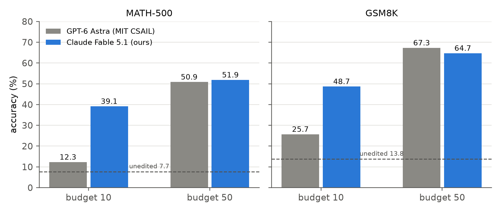
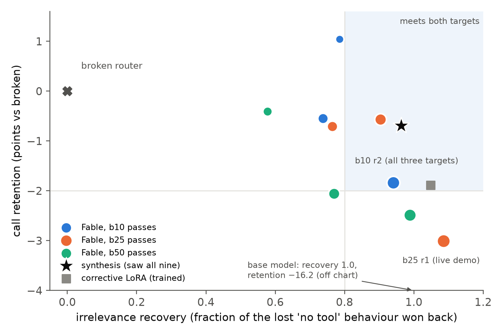
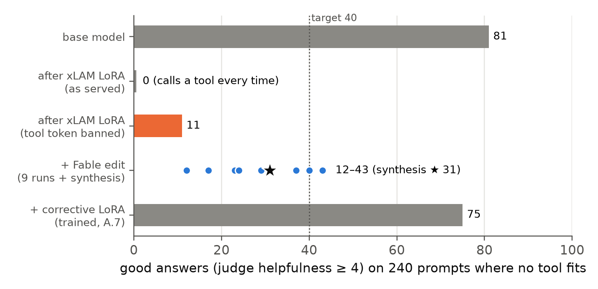

# Claude, please fix my model: replicating weight-space programming and applying it to a broken tool router

**Brad Hinkel**

*Draft, November 2026. An informal report in the style of a Patterns article. It is not peer reviewed, and the results are provisional.*

---

### Highlights
- We replicated MIT CSAIL's weight-space programming result on Qwen3.5-0.8B. Their published edit matched their published scores, and a different frontier model (Claude Fable 5.1) matched their driver's (GPT-6 Astra's) edit with the same budget of 50 forward passes.
- We then applied the same method to a common problem. A Qwen3.5-2B tool router fine-tuned on the xLAM dataset calls a tool for every prompt. In ten repair sessions, Fable found the same cause every time and fixed it with a small edit to one layer.
- The fix is small but the damage isn't. The fine-tune changed 58% of the weights. Fable didn't undo it; it cancelled its effect at one decision point.
- No step restored what nobody trained for. Answer quality fell when the router was fine-tuned and recovered only partly after the weight edits. A larger budget, of 50 passes instead of 10, made no measurable difference.

### In brief
A frontier model can read the weights of a smaller model and repair a defect introduced by fine-tuning, with no gradients and no training data. We first reproduced the original MIT CSAIL experiment, then applied the method, one change at a time, to a tool router broken by a standard fine-tuning recipe. The repair works, it is small, and it is the same repair from run to run. Like the fine-tune before it, it fixes only what it is aimed at.

---

## Summary
Weight-space programming means a frontier model editing another model's weights directly, by reasoning about them, with no gradient descent. It was introduced a few weeks before this work. We reproduced the original MIT CSAIL math experiment on Qwen3.5-0.8B and matched their numbers. Swapping their driver (GPT-6 Astra) for Claude Fable 5.1 gave equal or better edits for the same budget. We then applied the method to a practical problem.

We fine-tuned Qwen3.5-2B for tool calling on 58,000 xLAM examples, following the standard Hugging Face recipe. Call accuracy rose from 68.4% to 84.6%, but the model began calling a tool on 99% of prompts where none fits. In ten sessions Fable repaired it: it won back 58–109% of the lost "no tool" behaviour, mostly at a cost of under 2 points of call accuracy. Every session found the same cause, a near-constant offset toward calling a tool, and cancelled it in one layer. The pass budget (10, 25 or 50) had no measurable effect. A synthesis session that read all nine earlier runs gave the best balance of the ten. But none of the edits restored the base model's answer quality, which the fine-tune had removed and which no step in the pipeline was trained for.

## The bigger picture
Fine-tuning a small open model for one job is routine. Fine-tuning that quietly breaks something else is also routine, because a model learns exactly what its data shows and nothing it doesn't. Weight-space programming offers a different kind of fix. Instead of collecting new data and training again, you hand the model's weights to a frontier model, which inspects them, finds the defect and edits it out. For people who build with small models, this could become a diagnostic tool as well as a repair tool: the edit tells you *what* the fine-tune broke and *where*.

The method is about a month old. What we report here is a set of experiments, not a recipe. We report them with their caveats, in incremental steps, to encourage others to reproduce and extend them.

---

## Introduction
In November 2026, Rikiya Takehi, Jayden Teoh, Alex Zhang and Omar Khattab at MIT CSAIL described "Sparks of Weight-Space Programming" [1]. A frontier model, the *driver*, is given the weights of a smaller *target* model, a Python sandbox, and a small budget of forward passes on practice data. It must improve the target by editing its weights directly. Gradients, training and running the network inside the sandbox are not allowed. In their Experiment 8, the target is Qwen3.5-0.8B with thinking enabled. Its reasoning loops on "Wait" until it hits the 32k-token limit, so it scores 8% on MATH-500. GPT-6 Astra, given 50 forward passes, found a "loop direction" in two MLP layers. Subtracting it from 64 weight columns raised MATH-500 to 48%. No training data, gradients or labels were involved.

Could the same method repair a *defect introduced by fine-tuning*? Tool routing is a good test case. Small models make cheap, fast routers, and the standard way to improve them is LoRA fine-tuning on a function-calling dataset, as in the Hugging Face cookbook recipe on Salesforce's xLAM data [2, 3]. The resulting defect is well known: every one of the 60,000 xLAM examples ends in a tool call, so the model learns that the answer is always a tool call. Ask it for the freezing point of water and it calls a boiling-point tool.

We set out to answer three questions, in order:
1. Does the original experiment reproduce, and does it still work with a different driver?
2. Can a driver repair the over-calling defect in a fine-tuned tool router, while keeping the better tool calling?
3. How consistent is the repair from session to session, does a bigger budget help, and does a driver that has read every earlier attempt do better?

We also report a fourth finding we did not set out to measure: what happened to the router's answers once it stopped calling tools.

## Results

### Replicating the original experiment
We first reproduced MIT CSAIL's Experiment 8 with their published materials: the pinned model revision, their edits rebuilt with their scripts (all tensor hashes matched), their sampling settings, and their grader, which agreed with their recorded grades on all 800 answers we checked. Compared problem by problem with their published outputs (Figure 1), the unedited model scored 7.70 on MATH-500 (theirs 7.90) and 13.76 on GSM8K (13.84). Their budget-50 edit scored 50.85 (48.10) and 67.29 (67.10). Three of the four differences are within one standard error; the fourth is 2.8 standard errors above theirs, plausibly from serving-stack differences.

**Figure 1. Replicating Experiment 8.** MATH-500 and GSM8K accuracy for edits made by the original driver (GPT-6 Astra; budget 10 from their paper, budget 50 rerun in our pipeline) and by Claude Fable 5.1, run on their task text, rules and harness. Dashed lines: the unedited model.

We then made one change: the driver.
- **Budget 10.** Fable reached 39.1% on MATH-500 and 48.7% on GSM8K, against 12.3% and 25.7% for the original driver at the same budget. It scaled two columns: it doubled a neuron that suppresses "Wait" and halved one that promotes it, 2,048 weights in total.
- **Budget 50.** Fable matched the original driver's edit on MATH-500 (+1.0 ± 1.2 points) and was slightly behind on GSM8K (−2.6 ± 0.9). Its edit was different: 15 neuron columns that dampen specific loop words ("Wait", "Maybe", "Actually"…), plus one attention head zeroed that copied earlier "Wait"s.

The method reproduces, it isn't specific to one driver, and the edits are small and readable.

### A standard recipe, a known defect
The target for the rest of this work is Qwen3.5-2B used as a tool router, evaluated on the Berkeley Function Calling Leaderboard (BFCL v4) [4].
- **Base model:** it called tools correctly on 68.4% of prompts (the mean of six call categories) and correctly declined to call on 78.8% of the "irrelevance" prompts, where none of the offered tools fits.
- **Fine-tuning:** we trained a rank-16 LoRA on 58,000 xLAM examples and merged it. This follows the cookbook recipe [2], with a different base model, bf16 instead of 4-bit QLoRA, and slightly different hyperparameters.
- **Result:** call accuracy rose to 84.6%, but irrelevance fell to 0.8%. The model calls a tool on 238 of 240 prompts where no tool fits, and on 99% of real users' irrelevant requests. We call this the *broken* model.

The task for the driver was to restore "no call" behaviour without losing the better calling. We set three targets:
- **recovery** of at least 0.80 of the lost irrelevance score;
- **retention** within 2 points of the broken model's call accuracy;
- at least **40 good answers** out of 240 irrelevant prompts.

The base model gives 81 good answers. The broken model gives 0, because it always calls.

### A first attempt, and why we went back
We actually ran the router *before* replicating the original, and that was a mistake. Our first harness was written from the paper's description. One run per budget gave scattered results: budget 10 recovered fully but lost 15 points of call accuracy; budget 25 found a neat one-row edit to the token "I" (2,041 weights), with recovery 0.82 and retention −1.1. Then we measured answer quality: that model gave **4** good answers out of 240. It had learned to say "I can only do X" instead of calling a tool. With one run per budget and our own harness, we couldn't tell whether the agent, the task text, the rules or chance was responsible. So we stopped, replicated the original exactly, and reran the router as a single change from the replicated harness. All the router results below come from that harness.

### Ten repairs of the router
We ran Fable 5.1 on the router three times at each of three budgets (10, 25 and 50 forward passes), then once more as a synthesis. Each session had a Python sandbox over the broken model's weights (with read-only base weights and LoRA factors), four practice files, and three kinds of forward pass: generation, teacher-forced reads, and a judge pass that grades text answers (Methods). Sessions took 2–5.5 hours. None saw the test set.

| run | irrelevance (%) | call acc. (%) | recovery | retention (pts) | good / 240 |
|---|---|---|---|---|---|
| base model | 78.8 | 68.4 | 1.00 | −16.2 | 81 |
| broken (xLAM LoRA) | 0.8 | 84.6 | 0 | 0 | 0 |
| corrective LoRA (trained) | 82.5 | 82.7 | 1.05 | −1.9 | 75 |
| Fable, budget 10 (3 runs) | 64.9 ± 8.3 | 84.2 ± 1.4 | 0.82 ± 0.11 | −0.5 ± 1.4 | 25 ± 14 |
| Fable, budget 25 (3 runs) | 72.4 ± 12.5 | 83.2 ± 1.4 | 0.92 ± 0.16 | −1.4 ± 1.4 | 33 ± 10 |
| Fable, budget 50 (3 runs) | 61.5 ± 16.1 | 83.0 ± 1.1 | 0.78 ± 0.21 | −1.7 ± 1.1 | 28 ± 10 |
| Fable, synthesis (1 run) | 75.8 | 83.9 | 0.96 | −0.7 | 31 |

**Table 1.** BFCL v4 test results (mean ± SD over runs). Call accuracy is the mean of six call categories. The corrective LoRA is a trained baseline, described in the Discussion.

**Every session repaired most of the defect** (Figure 2):
- recovery ranged from 0.58 to 1.09;
- eight of ten edits lost less than 2.1 points of call accuracy, and none lost more than 3.1;
- one run, b10 r2, met all three targets.

**The spread between runs is real, not test-set noise.**
- The irrelevance score has a sampling error of about ±3 points on 240 prompts, but runs differ with a standard deviation of 12 points.
- Each run chose how strong to make its edit from its own practice-set measurements. That choice sets where it lands on a trade-off: across the ten edits, recovery and retention are correlated at about −0.6, so more recovery costs some call accuracy.

**The pass budget made no measurable difference.**
- A one-way ANOVA across the three budgets gives F = 0.57 for irrelevance and F = 0.71 for retention; significance at 5% would need about 5.1.
- More passes changed what Fable measured: budget-50 runs spent up to 22 passes on judging answers. They didn't change what it built, or how well the edit worked.
- Budget-50 sessions took about twice as long as budget-25 sessions and cost about twice as much.

**Figure 2. Ten weight-space repairs of the tool router.** Each point is one session's edit, scored on the BFCL v4 test split. Colour shows the pass budget and marker area the number of good answers. The shaded region meets both the recovery and the retention targets. The star is the synthesis session, which read all nine earlier runs. The square is a corrective LoRA trained with gradients on 3,000 added "no tool fits" examples.

### Small fix, widespread damage
**The same diagnosis in every run.** All nine independent sessions reached the same diagnosis, and the synthesis confirmed it:
- The fine-tune did **not** destroy the model's judgement of relevance.
- At the token where the model decides between calling a tool and writing text, the margin for `<tool_call>` over the best ordinary word is 8.1 ± 1.6 logits on irrelevant prompts and 11.7 ± 0.6 on relevant ones (AUC 0.96, against 0.92 for the base model).
- The relevance signal is intact; it is shifted by a near-constant offset of about 10 logits toward calling.

**The fix: cancel the offset at the readout.** Every run fixed it there, by editing layer 23's MLP output projection (`mlp.down_proj`), the last layer before the output.
- **Size:** relative changes of under 1% to 11% of that one tensor (one run, b50 r2, wrote into 45 near-empty columns, so its relative change is larger).
- **Form:** some edits rewrote one or a few neuron columns. Neuron 3776, which fires at the decision token and more strongly on irrelevant prompts, was found independently by two sessions. Others added rank-1 to rank-4 corrections.
- **Exceptions:** two runs changed more:
  - b10 r1 also reverted the LoRA in 34 attention tensors;
  - b50 r2 also edited the matching rows of `gate_proj`, so its neurons fire only at the decision token.

**Fable compensated rather than removed.** The LoRA changed 58% of all the model's weights, and the defect turned out to be redundant across them. Several sessions tried reverting the LoRA in groups of layers:
- reverting either half of the network (blocks 0–11 or 12–23) left the model calling on 86–100% of irrelevant prompts;
- partial reverts cost 3–17 points of call accuracy.

So no session removed the fine-tune's damage. Each added a small counter-offset at the one place where the offset turns into a decision: understand the defect, then compensate for it. That makes the edit small, readable and effective. It also explains the limit described next.

### What nobody trained for: answer quality
BFCL's irrelevance score only checks that no tool was called. To see what the model said instead, we had every text answer graded by a blind judge:
- **the judge:** Claude Sonnet 5.5, given answers from all models shuffled together and anonymised;
- **the rubric:** helpfulness 1–5, where a "good" answer scores at least 4, meaning it answers the question or explains the limitation and still helps; plus fluency, loop detection and a category (answered, declined with help, declined only, degenerate);
- **its consistency:** regrading gave 79–96% exact agreement and over 99% within one point, so each count is good to about ±3.

The results are in Figure 3:
- **Base model:** 81 good answers.
- **Broken model:** 0, because it always calls.
- **Broken model forced to answer:** we banned the `<tool_call>` token, which forces the broken model into text. It gave only **11** good answers, and in 92 of 240 cases it wrote out a tool call anyway without the opening token. Its text answers were mostly refusals of questions it knows, for example: "I cannot provide information about the evolutionary history of pandas as I do not have access to that specific knowledge."
- **Fable's ten edits:** 12–43 good answers, mean 29. The rest are mostly bare refusals, plus some loops.

So the fine-tune did not just hide the model's ability to answer; it largely removed it. Fable's edits recover part of it. They don't make answers worse than the fine-tune left them, but their changes at the readout can't restore what the fine-tune removed upstream.

**Figure 3. Answer quality at each step,** on the 240 test prompts where no offered tool fits. "Tool token banned" forces the fine-tuned model to answer in text, which shows what answering ability it has left. Blue dots are the nine repeat sessions and the star is the synthesis.

### Synthesis: reading every earlier attempt
For the last session (25 passes), Fable got a read-only folder with all nine earlier runs, shuffled and without test scores: their tensors, reports, notes and practice measurements. It reproduced the strongest earlier edit (neuron 3776), noted that this neuron also fires inside call arguments and at paragraph starts, and rebuilt the fix as a rank-4 change to the same layer-23 tensor. The new edit adds a nudge toward answers that open with "To", a stronger end-of-turn signal (loops come from a weak stop), and a guard against late tool calls. It reached recovery 0.96 and retention −0.7, the best balance of the ten edits, but its 31 good answers miss the target of 40.

The synthesis is one run, about 0.8 standard deviations above the nine-run mean on irrelevance. The fair summary is that seeing the earlier runs produced a cleaner edit, not a better ceiling.

## Discussion

### The model learns exactly what it is trained on
The xLAM LoRA did what its data asked. All 58,000 training examples end in a tool call, and none shows the response "no tool fits, so answer directly" or "no tool fits, and I can't help". The model learned to call tools better, and also learned to always call and, when it can't, to refuse. The problem is well known: a separate dataset, xlam-irrelevance-7.5k [5], exists to fill exactly this gap.

The corrective LoRA shows the proper fix is data:
- **What it was:** a second LoRA trained on 3,000 "no tool fits" examples, answered by the base model, plus 3,000 ordinary call examples.
- **Result:** it met all three targets, with recovery 1.05, retention −1.9 and **75** good answers.

Weight-space editing found and patched the defect without any data, and it told us exactly where the defect sits. It did not restore what the training data never contained.

**The same lesson applied to our own data.** In an early round, every irrelevant practice prompt came from real users and every relevant one was synthetic xLAM text. Fable built a probe to separate irrelevant from relevant, and the probe partly learned "sounds like a real user" instead. The resulting edit stopped calling tools on real users' *relevant* requests and lost 19 points of call accuracy. We rebuilt the practice data with both styles on both sides, and later sessions didn't repeat the problem. Bias in the data shows up at every step, including in the data you give the agent.

### Measure what you didn't train for
The most important measurement in this project was one we added late: answer quality. BFCL's irrelevance score rewarded a model that said "I can only call functions" exactly as much as one that answered the question. Without the judge, our first edit, which gave 4 good answers, would have looked like a success. Most of the failures in this project were never anticipated:
- the refusal template;
- the style shortcut in the practice data;
- answers that loop until the token limit;
- call accuracy lost only on real users' single-call requests, a category the practice data didn't cover.

Each was found only because something outside the training objective was measured. This is the honest caveat for weight-space editing, and for fine-tuning too: you get what you measure and pay for what you don't.

### These are experiments, not a method
Weight-space programming is weeks old, and what we know is limited:
- **Scope:** one model family (Qwen3.5), one task per domain, and about ten runs.
- **Variation:** the spread between runs is large, about 12 points of irrelevance.
- **Answer quality:** unsolved.
- **Choosing a run:** there is no reliable way to pick the best one from practice data. Practice and test agreed well on recovery (Spearman ρ 0.84), but disagreed on answer quality (ρ −0.55). The practice judge set was too small to rank the runs.

What is encouraging:
- the method reproduces;
- a different driver can do the job;
- the diagnosis is consistent across ten independent sessions;
- the edits are small enough to read.

### For tinkerers: work in small, gated steps
The most useful practice in this project was ordinary experimental discipline. We list it because we learned some of it the hard way.
1. **Replicate the original first.** Ask your coding agent to read the paper and reproduce it, then check that your numbers match theirs within a stated tolerance: per problem, with standard errors, using their grader. We skipped this at first and got results we couldn't interpret. The agent can do most of the work, but you decide what counts as a match.
2. **Then change one thing at a time, with a gate at each step.** Our steps were:
   1. test the base model on BFCL;
   2. train the xLAM LoRA and confirm both the gain and the defect;
   3. confirm the replication;
   4. swap the driver;
   5. swap the target;
   6. repeat the sessions for statistics;
   7. run the synthesis.

   Each step had to pass before the next began.
3. **Write predictions down before each run.** Ours were often wrong: we expected a larger budget to help, and it didn't. Writing them first is what makes that visible.
4. **Keep the test set out of the agent's reach.** The driver never saw test items. Practice data was checked against the test set for overlap.
5. **Measure what you didn't train for.** See above.

### Next steps
**A smaller model: Waterbirds.** To see whether the approach carries over to computer vision, and to get more runs for less, we applied it to a ResNet-50 image classifier (23.5M weights).
- **The setup mirrors the router:** trained on Waterbirds [6], where bird type correlates with background, the model learns the shortcut: 98.3% average accuracy but 75.4% on waterbirds shown on land. The published fix, Deep Feature Reweighting (DFR) [7], retrains the last layer and reaches 92.6 ± 0.5% worst-group in our 20-seed rerun.
- **Fable's edits:** in nine sessions that allowed closed-form fitting, they reached 93.3 ± 0.3% worst-group, consistently above DFR's mean. The gain of about 0.7 points is below what the test set can resolve for any single run.
- **The edits were again small:** most changed only the final layer's 4,098 weights, cancelling the background direction.
- **A synthesis session did worse than DFR,** at 91.6%. It set its decision threshold on an assumption about the test set taken from its own prior knowledge.

Small models make it cheap to run many sessions, which is what this kind of experiment most needs. We plan to extend this to a general image model on a standard dataset.

**Synthesis as a way to dig deeper.** In both domains, giving the driver all the earlier runs produced a cleaner edit but not a better result. The bottleneck is measurement, not ideas: the practice set limits what any session can verify. Larger and better-matched practice sets, especially for judging answers, are the next thing to try.

**Upstream edits for answer quality.** Every router edit acts at the readout. Restoring helpful answers probably needs an edit where the fine-tune changed the model's stance, earlier in the network. No session managed that within its budget.

## Methods

### Models and data
- **Replication target:** Qwen3.5-0.8B (pinned revision) with thinking on.
- **Router target:** Qwen3.5-2B, with thinking off:
  - 24 layers, 18 of them Gated DeltaNet linear-attention layers and 6 full-attention layers;
  - SwiGLU MLPs of width 6,144;
  - tied embeddings.
- **Fine-tuning (A.2):**
  - Salesforce/xlam-function-calling-60k [3], split 58,000 train and 2,000 practice;
  - LoRA rank 16, α 32, learning rate 2e-4, one epoch, 1,300 steps of 32k tokens;
  - applied to all attention, MLP and linear-attention projections, then merged into the weights.
- **Corrective LoRA:** trained on top of the broken model with the same settings. Its data was 3,000 mismatched xLAM query/tool pairs answered by the base model (self-distillation), plus 3,000 ordinary call examples.

### Harness and rules
The router harness is the replicated Experiment 8 harness with the task swapped. The driver runs in headless Claude Code with only two tools, `python` and `forward`.

- **`python`:** a persistent kernel with no GPU and no network, confined to the read-only model files and practice data and a working folder. Helpers load the broken and base weights and the LoRA factors, and save edits.
- **`forward`:** one pass from the budget: generation on up to 512 practice items, scored as the evaluation scores them (single or paired, optionally saving activations); a teacher-forced read of up to 1,024 texts; or a judge pass on up to 128 text answers.
- **Not allowed:** gradients, autograd, optimisers or iterative fitting of weights; simulating the network in the kernel; internet access. **Allowed:** closed-form solutions such as least squares on saved activations.

**Audit:** every session's Python calls were audited after the run. Five of the nine repeat sessions recomputed MLP sublayers from saved activations, fully or partly, for diagnosis. We kept and flagged these runs. This capability should be stated explicitly in future rules.

### Practice and evaluation
**Practice files:** real users' irrelevant requests (BFCL live_irrelevance minus test overlaps, 854), synthetic irrelevant requests (xLAM queries with unrelated tools, 600), xLAM examples (2,000), and real users' relevant requests from BFCL categories not in the test set (56). **Evaluation:** BFCL v4 test categories, chat template with thinking off, greedy decoding up to 4,096 tokens.

**Headline measures:**
- *irrelevance recovery* = (edited − broken) / (base − broken) on test irrelevance;
- *retention* = edited − broken mean call accuracy over six categories;
- *good answers* from the blind judge.

### Sessions and cost
**Driver:** Fable 5.1 at maximum effort, billed to a Claude Max subscription. Notional API cost per session (driver only):

| budget | notional cost per session |
|---|---|
| 10 | $18–27 |
| 25 | $26–34 |
| 50 | $41–59 |
| synthesis | $31 |

**Hardware and cost:** A40 GPUs ($0.59/h) served the forward passes and evaluations. The ten router sessions and their evaluations cost about $41 of GPU time in total.

**Statistics:** standard errors are over prompts. Variation between runs is reported as the SD over three runs per budget. Predictions for every stage were written down before each run.

## Resource availability

### Lead contact
Brad Hinkel, brad@bradhinkel.com

### Materials availability
This study did not generate new physical materials. The edited model tensors are in the repository.

### Data and code availability
- **Code and records:** https://github.com/bradhinkel/weight-space-tuning. It contains:
  - the harness, task texts and evaluation scripts;
  - per-session transcripts and notes, and the submitted edits;
  - all reports (`reports/`), and the scripts that produce this paper's figures.
- **Public data:** BFCL v4, xLAM-60k, MATH-500, GSM8K and Waterbirds.
- **Live demo:** the base model, the fine-tuned router and Fable's fix running side by side (`exp_r/r4a/demo_web.py`).

## Acknowledgments
Thanks to Rikiya Takehi, Jayden Teoh, Alex Zhang and Omar Khattab for publishing their task texts, edits and per-problem outputs, which made an exact replication possible. Thanks also to the Hugging Face cookbook authors and to the BFCL and xLAM teams.

## Author contributions
B.H. conceived the study, set the experimental design and the gates between steps, made the predictions and interpreted the results. The harness, runs, analysis and draft text were produced with Claude Code (see below).

## Declaration of interests
The author declares no competing interests.

## Declaration of generative AI and AI-assisted technologies
This work was carried out with AI as both subject and tool:
- Claude Fable 5.1 (Anthropic) was the driver that edited model weights.
- Claude Sonnet 5.5 was the answer-quality judge.
- Claude Code (Claude Opus 5.5) built the harnesses, ran and audited the experiments, wrote the stage reports and drafted this paper under the author's direction.

The author reviewed and takes responsibility for the content.

## References
1. Takehi R, Teoh J, Zhang A, Khattab O. Sparks of weight-space programming. MIT CSAIL, November 2026. https://rikiyat.github.io/blog/weight-space-programming/ (logs: https://github.com/RikiyaT/lm_understand-logs)
2. Azarkhalili B. Fine-tuning LLMs for function calling with xLAM dataset. Hugging Face Cookbook. https://huggingface.co/learn/cookbook/function_calling_fine_tuning_llms_on_xlam
3. Liu Z, et al. APIGen: automated pipeline for generating verifiable and diverse function-calling datasets. arXiv:2406.18518 (2024). Dataset: Salesforce/xlam-function-calling-60k.
4. Patil SG, et al. The Berkeley Function Calling Leaderboard (BFCL). https://gorilla.cs.berkeley.edu/leaderboard.html
5. Lin Q, et al. Hammer: robust function-calling for on-device language models via function masking. arXiv:2410.04587 (2024). Dataset: MadeAgents/xlam-irrelevance-7.5k.
6. Sagawa S, Koh PW, Hashimoto TB, Liang P. Distributionally robust neural networks for group shifts. ICLR (2020).
7. Kirichenko P, Izmailov P, Wilson AG. Last layer re-training is sufficient for robustness to spurious correlations. ICLR (2023).
8. Hintze A, Proschinger Åström F, Schossau J. Autonomous language-image generation loops converge to generic visual motifs. Patterns 7, 101451 (2026). (Format template.)
